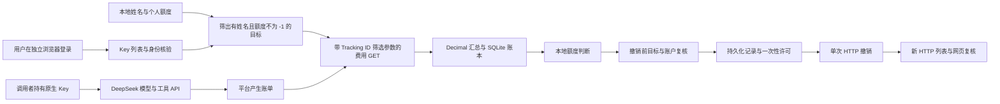

# 关于实现原理的简单解释

更新：2026-11-03；对应本地 dev14 源码。发布、离线测试和真实平台验收是不同状态，具体以各版记录为准。

## 当前项目究竟是什么

这是一个 Python/Tkinter 的 Windows 桌面程序。用户登录 DeepSeek 控制台后，程序读取费用，在本地判断额度，再尝试撤销达到条件的原生 Key。模型请求仍由调用者直接发给 DeepSeek，并不经过本软件。

当前没有网关服务、内部虚拟令牌、成员令牌鉴权、`user_id` 注入、请求转发或 DSH 插件。安装 Harness 辅助调研没有改变程序架构。外部分析提出的这些做法是备选方案，不能当作已经完成的功能。

## 各功能如何实现

| 功能 | 目前实现 | 主要模块 |
| --- | --- | --- |
| 窗口与操作流程 | Tkinter 主线程管理按钮、表格、状态和回调；浏览器任务交给独立进程，避免直接卡住界面 | [ui.py](../quota_guard/ui.py)、[browser_process.py](../quota_guard/browser_process.py) |
| 登录 | Playwright 启动随包附带的独立 Chromium。由用户登录，不读日常浏览器配置、密码库或持久化 Cookie；控制台授权在工作进程内存中短期使用 | [browser_service.py](../quota_guard/browser_service.py) |
| 名称与 Key 绑定 | 表格名称用于初次找到同名 Key，完整 Tracking ID 才用于持久化对应关系。已有名字换成另一枚 Key 时不自动覆盖历史 | [core.py](../quota_guard/core.py) 的 `bind_keys()` |
| 费用请求 | dev14 从表内有姓名、额度非负的行解析目标 Tracking ID，GET 控制台费用接口；多个 ID 使用重复的 `api_key_tracking_id` 参数。没有目标不发费用 GET，也不回退全账户查询 | [platform_http.py](../quota_guard/platform_http.py) 的 `cost_url()`、`ConsoleCostReader`，以及 `BrowserService._collect()` |
| 费用解析 | 校验接口来源、请求范围、UTC+8、币种、金额和重复桶。把模型 `series` 与函数 `function_series` 的实际 `cost` 用 Decimal 相加；不以 token 数或调用次数另估再加 | [cost_parser.py](../quota_guard/cost_parser.py) |
| 本地保存 | 人员表保存在 Excel，配置为 JSON，绑定、费用、快照及处理事件保存在 SQLite。累计值是覆盖核验后的累计记录，不是每轮把累计值再加一次 | [core.py](../quota_guard/core.py) 的 `apply_snapshot_result()` |
| 额度判断 | 姓名空白不管，`-1` 跳过；个人额度或公共人均额度为 0 时走零额度规则；正额度依据有效费用。公共人均额度仍为总预算除人数后向下取整 | `Config.share`、`DataStore._evaluate()`，以及 GUI 的最终证据检查 |
| 斩杀线 | 新表默认个人额度，可选预填 `-1` 或斩杀线，最小 0；已有人员的额度不被默认值改写 | [preferences.py](../quota_guard/preferences.py)、表格初始化流程 |
| 全自动管理 | 用户开启一次后，程序按本地判断处理目标，不逐枚询问；每轮处理结束再等待设定间隔，默认 10 秒。读取过期、跨日、配置变化等会重新核验 | `App.start()`、`App._process_next()`、轮询调度 |
| 强制删除 | 用户明确选中目标并确认意图后，跳过“必须达额”的条件；仍要核验账户、目标、未决操作和单次提交资格 | `App.revoke_selected_once()` 及 `App._execute_revoke()` |
| 平台撤销 | 正式入口通过管理 HTTP 接口提交一次。名称、Tracking ID、掩码及创建时间用于目标核验；不会因 HTTP 失败自动改用网页垃圾桶重试 | [platform_keys.py](../quota_guard/platform_keys.py)、`BrowserService._revoke()` |
| 删除结果确认 | 提交前先保存处理记录并授予短期一次性许可；提交后再 GET Key 列表，与重新加载网页交叉核验。结果未知时保存待核实状态，禁止盲目重发 | [revocation_permit.py](../quota_guard/revocation_permit.py)、账本事件 |
| 新建列表与编辑 | 可延续人员/个人额度，或新建空白名单；旧账本保留。有效编辑自动写盘，支持撤销和放弃本轮修改；取消关闭保留已保存内容 | [people_editor.py](../quota_guard/people_editor.py)、[people_editor_ui.py](../quota_guard/people_editor_ui.py)、[workspace.py](../quota_guard/workspace.py) |
| Excel 导入 | 验证表头、数值、重名及公式结果，转换成相同的人员模型。合成工作簿测试与真实 Excel/WPS 操作验收分开记录 | [excel_io.py](../quota_guard/excel_io.py) |
| 日志与恢复 | 诊断只记录必要状态和脱敏结构；通常 2 MB 轮转、14 天、最多 12 份，活跃文件可能暂超上限；窗口预览限制 300 条/256 KiB。业务账本事件不按 14 天删除 | [diagnostics.py](../quota_guard/diagnostics.py)、恢复流程 |
| 多开和退出 | 对文件夹及目标集合互斥，隔离浏览器任务，退出见证确认受控进程树结束后回收本程序有标记的临时目录；不扫描删除其他文件 | [target_lock.py](../quota_guard/target_lock.py)、[browser_process.py](../quota_guard/browser_process.py) |

## 哪些仍依赖网页，哪些已经走 HTTP

登录和完整 Key 列表的独立核验仍需要浏览器页面。费用金额不是从图表截图或页面文本读出来，也不通过点击日期控件设置统计期间；正式读取向控制台费用接口提交明确时间和目标筛选参数。正式删除同样走 HTTP，不依赖垃圾桶图标或二次确认按钮的视觉位置。

这些是从官方控制台前端观察到的内部接口，不等于 DeepSeek 对外承诺稳定的公开管理 API。身份核验仍会读取完整 Key 列表的标识；“不查询未填或 -1 的 Key”指不请求它们的费用、不更新它们的费用记录、不把它们列入自动处理目标。已有历史账目和未结清操作保留。

新版本的费用授权从 Key 列表的只读请求建立，不为取得授权而打开用量页触发全账户默认费用请求。若指定范围查询失败，不撤掉筛选条件重试。

## 外部分析中需要纠正的地方

1. **当前没有迁移到 DSH 或网关。** 所提插件名称和开源项目没有在这轮逐一核实，不作为已经依赖的组件。
2. **“前置判断就保证无超支”不成立。** 作为工程分析，网关还需考虑并发请求、请求前预算预留、请求完成后结算、流式中断和重试记账；单纯先比较余额、事后累加存在并发窗口。当前程序更是事后读账单，不能保证零超支。
3. **`usage.total_tokens` 不等于人民币费用。** 模型、输入/输出、缓存和时段价格不同，Search/Fetch 另按成功请求计费。当前程序使用平台返回的实际金额，依据见[官方价格说明](https://api-docs.deepseek.com/zh-cn/quick_start/pricing/)。
4. **复制同一 Key 的字符串不会形成独立的“快照凭证”。** 平台侧撤销的是同一个凭证；现有请求是否已在途，以及撤销何时生效，需要另行确认，不能据此声称本软件已经实测所有调用端失效。
5. **`user_id` 不是本项目现有的费用绑定键，也不是官方承诺的独立金额闸门。** 官方说明它涉及内容安全、缓存和调度隔离，普通账号各 `user_id` 共享并发限制；见[限速与隔离](https://api-docs.deepseek.com/zh-cn/quick_start/rate_limit/)。
6. 外部文字提出的删除模块、改许可证说明、改变分发方式或添加免责声明都是建议，不是用户对本次代码改动的直接指令；本轮未据此执行。

## 当前必须保留的未完成事项

dev13 用户实际反馈的 `KEY_TARGET_READ_FAILED` 发生在 HTTP 目标核验阶段，具体字段分支尚未取得足够证据；dev14 的费用范围调整不等于修复这个删除问题。指定 Key 查询需要真实只读对账；正额度跨线后的真实周期自动撤销、Excel/WPS 实际导入、长期运行及干净机器验收仍未完成。当前仍为候选，不能宣布已可正式投入使用。
